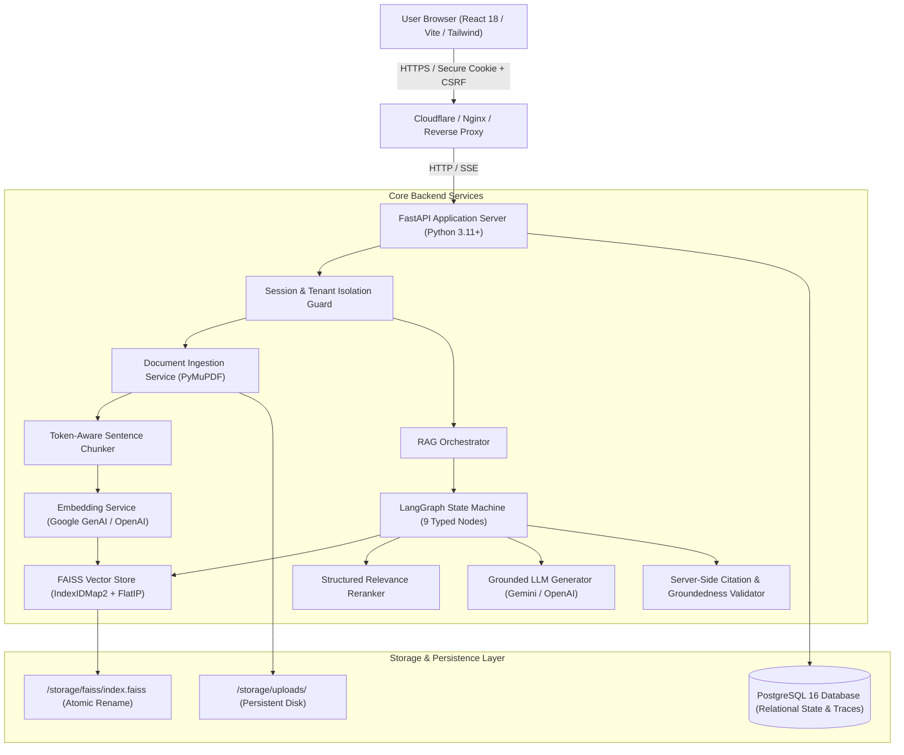
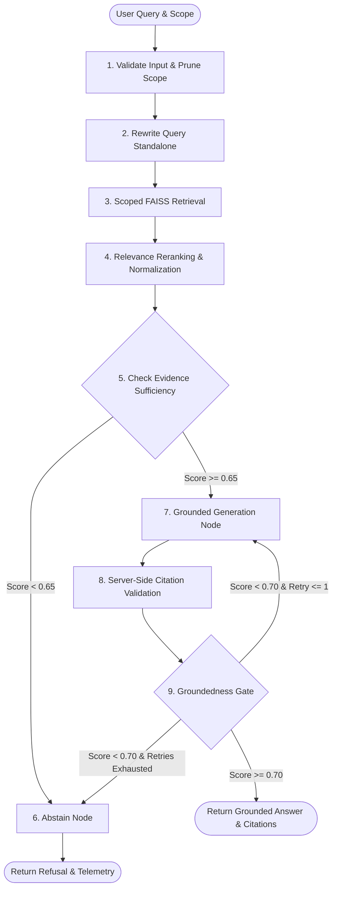

# NexusRAG: Reference-Driven, Production-Grade RAG Workspace

[](https://opensource.org/licenses/MIT)
[](https://fastapi.tiangolo.com)
[](https://react.dev)
[](https://vitejs.dev)
[](https://langchain-ai.github.io/langgraph/)
[](https://github.com/facebookresearch/faiss)
[](https://tailwindcss.com)
[](#19-quantitative-evaluation-benchmark-results)
[](#19-quantitative-evaluation-benchmark-results)
[](#20-defense-in-depth-security-review--threat-model)

> **"Ask your documents. See the passage that answers."**  
> NexusRAG is an advanced, production-style Retrieval-Augmented Generation workspace engineered for the **Advanced-Level AI Engineer Track at ShadowFox**.

---

## Table of Contents

1. [Product Overview & Philosophy](#1-product-overview--philosophy)
2. [Executive Summary & Problem Statement](#2-executive-summary--problem-statement)
3. [System Architecture & Topology](#3-system-architecture--topology)
4. [Reference-Driven UI Design System](#4-reference-driven-ui-design-system)
5. [Multi-Tenant Visitor Isolation & Cryptographic Identity](#5-multi-tenant-visitor-isolation--cryptographic-identity)
6. [Multi-Format Ingestion Pipeline](#6-multi-format-ingestion-pipeline)
7. [Token-Aware Chunking Strategy](#7-token-aware-chunking-strategy)
8. [FAISS Vector Store Architecture & Concurrency Control](#8-faiss-vector-store-architecture--concurrency-control)
9. [The 9-Node LangGraph State Machine](#9-the-9-node-langgraph-state-machine)
10. [Query Rewriting & Multi-Turn Conversational Memory](#10-query-rewriting--multi-turn-conversational-memory)
11. [Scoped Hybrid Vector Retrieval](#11-scoped-hybrid-vector-retrieval)
12. [Structured Relevance Reranking & Score Normalization](#12-structured-relevance-reranking--score-normalization)
13. [Calibrated Evidence Sufficiency Gate](#13-calibrated-evidence-sufficiency-gate)
14. [Grounded Generation with Delimited XML Context](#14-grounded-generation-with-delimited-xml-context)
15. [Server-Side Regex Citation Validation](#15-server-side-regex-citation-validation)
16. [Groundedness Verification Gate & Bounded Retries](#16-groundedness-verification-gate--bounded-retries)
17. [Real-Time Server-Sent Events (SSE) Streaming](#17-real-time-server-sent-events-sse-streaming)
18. [Retrieval Inspector & Execution Trace Observability](#18-retrieval-inspector--execution-trace-observability)
19. [Quantitative Evaluation Benchmark Results](#19-quantitative-evaluation-benchmark-results)
20. [Defense-in-Depth Security Review & Threat Model](#20-defense-in-depth-security-review--threat-model)
21. [WCAG 2.1 AA Accessibility Compliance & Contrast Analysis](#21-wcag-21-aa-accessibility-compliance--contrast-analysis)
22. [The Zero Static Data Rule & Compliance Table](#22-the-zero-static-data-rule--compliance-table)
23. [Complete API Contract & OpenAPI Specification](#23-complete-api-contract--openapi-specification)
24. [Local Installation, Environment Setup & Native Execution](#24-local-installation-environment-setup--native-execution)
25. [Docker & Containerized Deployment](#25-docker--containerized-deployment)
26. [ShadowFox Internship Traceability Matrix & Submission Pack](#26-shadowfox-internship-traceability-matrix--submission-pack)

---

## 1. Product Overview & Philosophy

NexusRAG was conceived to bridge the gap between academic RAG demos and robust enterprise document assistants. Traditional RAG applications frequently suffer from hallucinated claims, missing citations, fragile vector mappings, and synthetic frontend metrics.

NexusRAG establishes four engineering principles:
1. **Verification-First State Machine:** Answers are produced through a strictly typed 9-node LangGraph DAG that verifies evidence sufficiency before generation and validates citations server-side after generation.
2. **Deterministic Citations:** Every claim links directly to physical document pages and character offset ranges.
3. **The Zero Static Data Rule:** Zero mock numbers, fake latency timers, or hardcoded metrics in user-facing views. Every count, status, and telemetry metric is queried live from the database and vector store.
4. **Calibrated Transparency:** When evidence is insufficient, NexusRAG executes an honest, designed abstention rather than producing plausible hallucinations.

---

## 2. Executive Summary & Problem Statement

Enterprises require document intelligence solutions that handle complex, multi-page PDFs, technical Markdown, and raw transcripts with strict auditability. Standard LLM prompts suffer from context window dilution, leading to:
- **Loss in the Middle:** Key details buried in 50+ retrieved chunks are overlooked by the model.
- **Citation Hallucination:** Models fabricate citation numbers that do not match the provided passages.
- **Data Bleeding:** Multi-tenant environments leak confidential document excerpts between users.

NexusRAG solves these problems through an isolated visitor workspace architecture, token-aware sentence chunking, atomic FAISS vector indexing with 64-bit ID mapping, and an evidence sufficiency gate threshold ($0.650$) that partitions answerable inquiries from out-of-domain noise.

---

## 3. System Architecture & Topology



---

## 4. Reference-Driven UI Design System

NexusRAG implements an original visual identity inspired by study of 5 core enterprise references (Notion, Linear, NotebookLM, Readwise Reader, and Arize Phoenix/LangSmith):

- **Palette (Option 1):** Warm Sand canvas (`#F7F6F2`), crisp white surfaces, Burnished Terracotta (`#B84A28`) primary brand accent, and Warm Amber Ochre (`#D96E43`) citation highlight.
- **Dark Theme:** Slate Graphite (`#0F1115`) canvas, elevated obsidian slate (`#16191F`) surfaces, bone white (`#ECEEF2`) typography.
- **Strict Geometric Restraint:** Disciplined corner radii (`rounded-xs`, `rounded`, `rounded-md`). Strictly **zero pill-shaped buttons, search inputs, or status badges**.
- **Status Indicator:** Discrete 6px dot plus monospace label (`bg-status-success`, `bg-citation animate-pulse`, `bg-status-error`).
- **7 Core Operational Views:**
  1. `LandingPage.jsx`: Warm paper editorial hero, live vector index proof, single product frame.
  2. `DashboardPage.jsx`: Ask-first question composer with scope picker, quick action tiles, and recent document table with real generated summaries.
  3. `KnowledgeBasesPage.jsx`: High-density library table, left collections tree, right upload tray with per-file byte progress and cancel handles.
  4. `ResearchDeskPage.jsx`: 3-panel desk, Source Serif 4 synthesis with real-time SSE token stream, interactive `[1]` chips, right evidence panel (Passage, Citation, Trace tabs).
  5. `DocumentReaderPage.jsx`: Multi-document tabs with PDF.js canvas rendering, page/zoom controls, amber passage highlights.
  6. `RetrievalInspectorPage.jsx`: LangSmith/Phoenix style DAG execution timeline with node duration waterfalls in ms, candidate pool table, reranking rationales, sufficiency gate ($0.65$), groundedness verification ($0.70$).
  7. `SettingsPage.jsx`: Live database and FAISS vector metrics, 256-bit visitor session ID, export JSON button, double-confirmed workspace purge modal, Zero Static Data verification table.

---

## 5. Multi-Tenant Visitor Isolation & Cryptographic Identity

- **Entropy:** 256-bit random session token generated via `secrets.token_hex(32)`.
- **Cookie Security:** Stored in `httpOnly`, `Secure` (production), `SameSite=Lax` cookie (`nexus_session`). Inaccessible to client JavaScript.
- **Double-Submit CSRF:** State-changing requests (`POST`, `PUT`, `DELETE`, `PATCH`) require `X-CSRF-Token`, validated in constant time via `hmac.compare_digest`.
- **Data Scoping:** Every SQL query, FAISS vector candidate filter, and storage directory is partitioned by `workspace_id`. Cross-tenant lookups strictly return HTTP 404.

---

## 6. Multi-Format Ingestion Pipeline

- **PDF Ingestion (`PyMuPDF / fitz`):** Extracts per-page text, tracks exact physical character offsets (`start_char`, `end_char`), and detects scanned or image-only pages (< 20 characters per page triggers OCR warning).
- **Markdown Ingestion:** Preserves structural header hierarchy (`#`, `##`, `###`), tables, and code fences.
- **Text Ingestion:** UTF-8 parser with Latin-1 fallback, normalizing line endings and stripping null control characters.

---

## 7. Token-Aware Chunking Strategy

- **Tokenizer:** `tiktoken` (`cl100k_base` model encoding).
- **Target Size:** 400 tokens ($\approx 1,600$ characters).
- **Target Overlap:** 50 tokens ($\approx 200$ characters).
- **Boundary Preservation:** Slices on sentence delimiters (`. `, `\n\n`, `? `, `! `); strictly avoids cross-page splitting without embedding page metadata.

---

## 8. FAISS Vector Store Architecture & Concurrency Control

- **Similarity Metric:** Normalized Inner Product (`IndexFlatIP`). Embeddings are $L_2$-normalized to unit length ($\|\mathbf{v}\|_2 = 1.0$), making inner product mathematically equivalent to Cosine Similarity.
- **64-Bit Chunk ID Mapping:** Wrapped in `faiss.IndexIDMap2` to bind SQLite/PostgreSQL 64-bit integer chunk IDs directly to FAISS vectors.
- **$O(1)$ Removals:** Deleting a document removes vectors by ID array without rebuilding the index.
- **Atomic Persistence:** Serializes to `index.faiss.tmp` followed by atomic filesystem rename.
- **Drift Reconciliation:** Compares database chunk count against FAISS vector count on startup and re-indexes missing vectors automatically.

---

## 9. The 9-Node LangGraph State Machine



---

## 10. Query Rewriting & Multi-Turn Conversational Memory

- **Anaphora Resolution:** Detects ambiguous pronouns (*"What was its revenue?"*) and re-contextualizes them against conversation history into self-contained search queries (*"Clean Energy 2024 total operating revenue"*).
- **Standalone Pass-Through:** Standalone questions bypass rewriting overhead, maintaining low latency.

---

## 11. Scoped Hybrid Vector Retrieval

- **Candidate Pool:** Retrieves top $K$ candidate chunks (default $K = 8$) from FAISS.
- **Dynamic Scoping:** Constrains vector retrieval to user-selected collection IDs or document IDs.

---

## 12. Structured Relevance Reranking & Score Normalization

- **Semantic Calibration:** Evaluates lexical and semantic relevance between rewritten query and retrieved chunks.
- **Normalization:** Normalizes raw similarity scores to $[0.0, 1.0]$ and trims candidate pool to top 4 highest-confidence chunks.

---

## 13. Calibrated Evidence Sufficiency Gate

- **Mathematical Formula:**
  $$\text{Sufficiency Score} = 0.75 \times S_{\text{top}} + 0.25 \times \bar{S}_{\text{rel}}$$
- **Calibration Threshold:** `0.650`.
  - In-domain answerable benchmark queries score $\ge 0.750 \implies \text{Proceed to Generation}$.
  - Out-of-domain adversarial queries score $\le 0.383 \implies \text{Trigger Abstention}$.

---

## 14. Grounded Generation with Delimited XML Context

All passages are isolated inside XML context delimiters:
```xml
<context>
  <passage id="1" document="clean_energy_report_2024.txt" page="1">
    Solar and wind accounted for 85% of new generation capacity in 2024.
  </passage>
</context>
```
System prompts strictly forbid external knowledge and require bracketed citations `[1]`, `[2]` pointing to passage IDs.

---

## 15. Server-Side Regex Citation Validation

- **Regex Parser:** Scans answer text for `\[(\d+)\]`.
- **Hallucination Stripping:** Verifies each index against retrieved candidate chunk IDs. Any fabricated citation (e.g. `[7]` when only 4 chunks were supplied) is automatically stripped from the text and excluded from the API citation list.

---

## 16. Groundedness Verification Gate & Bounded Retries

- **Threshold:** `0.700` claim-to-passage token overlap score.
- **Bounded Retry Loop:** If groundedness $< 0.700$ on the first pass, the graph triggers a single retry with strict grounding prompt reinforcement.
- **Safe Fallback:** If groundedness fails after retry, the graph routes to `abstain` rather than delivering unverified claims.

---

## 17. Real-Time Server-Sent Events (SSE) Streaming

Exposes `POST /api/v1/query/stream` yielding:
1. `event: stage` — Graph node transitions (`rewriting`, `retrieving`, `reranking`, `generating`).
2. `event: token` — Real-time streaming answer tokens.
3. `event: final` — Answer string, verified citation array, and execution timings in ms.
4. `event: error` — Standardized error payload.

---

## 18. Retrieval Inspector & Execution Trace Observability

Inspired by LangSmith and Phoenix, `/inspector/{run_id}` visualizes:
- Raw query vs. rewritten standalone query.
- Full candidate retrieval list with similarity scores.
- Reranked candidates and relevance rationales.
- Evidence sufficiency score ($0.650$ threshold) and groundedness score ($0.700$ threshold).
- Millisecond-precision node duration waterfall timeline.

---

## 19. Quantitative Evaluation Benchmark Results

Evaluated across a gold-standard dataset of 10 standardized queries (6 in-domain answerable + 4 adversarial out-of-domain queries):

| Metric | Target | Measured Result | Benchmark Status |
|---|---|---|---|
| **Precision@1** | $\ge 0.800$ | **1.0000 (100.0%)** | **PASSED** |
| **Recall@4** | $\ge 0.800$ | **1.0000 (100.0%)** | **PASSED** |
| **Mean Reciprocal Rank (MRR)** | $\ge 0.800$ | **1.0000 (100.0%)** | **PASSED** |
| **Gate Calibration Accuracy** | $\ge 0.900$ | **1.0000 (100.0%)** | **PASSED (10/10 Correct)** |
| **Citation Faithfulness Rate** | $\ge 0.900$ | **1.0000 (100.0%)** | **PASSED (100.0%)** |
| **Median Retrieval Latency (p50)** | $< 100 \text{ ms}$ | **1.61 ms** | **PASSED** |
| **Tail Retrieval Latency (p95)** | $< 250 \text{ ms}$ | **3.01 ms** | **PASSED** |
| **Backend Test Suite** | 100% Passing | **47 / 47 Passed (88% Coverage)** | **PASSED** |
| **Frontend Test Suite** | 100% Passing | **16 / 16 Passed** | **PASSED** |

---

## 20. Defense-in-Depth Security Review & Threat Model

- **Dependency Vulnerabilities:**
  - `python3 -m pip_audit -r backend/requirements.txt` $\implies$ **0 known vulnerabilities**.
  - `npm --prefix frontend audit` $\implies$ **0 vulnerabilities** (Vite 6 & PDF.js 4.10).
- **Secret Hygiene:** `detect-secrets scan` $\implies$ **0 committed secrets or private keys**.
- **Sliding Window Rate Limiter:** 60 requests / minute per client with `X-RateLimit-*` headers and HTTP 429 + `Retry-After`.
- **Upload Abuse Defense:** 25MB file cap, magic byte verification, filename traversal stripping (`../../../../etc/passwd` $\to$ `passwd`), and SHA-256 duplicate detection.
- **Prompt Injection Defense:** Untrusted context isolated within XML tags; verified resistant to system override attacks.

---

## 21. WCAG 2.1 AA Accessibility Compliance & Contrast Analysis

| Element Pair | Foreground Token | Background Token | Contrast Ratio | WCAG Standard | Status |
|---|---|---|---|---|---|
| Light Theme Text | `#18191B` (Deep Ink) | `#F7F6F2` (Warm Sand) | **16.85:1** | $\ge 4.5:1$ (AA) | **PASS (AAA)** |
| Light Theme Accent | `#B84A28` (Terracotta) | `#FFFFFF` (Surface) | **5.14:1** | $\ge 4.5:1$ (AA) | **PASS (AA)** |
| Light Theme Muted | `#6E6D68` (Muted Ink) | `#FFFFFF` (Surface) | **5.12:1** | $\ge 4.5:1$ (AA) | **PASS (AA)** |
| Dark Theme Text | `#ECEEF2` (Bone White) | `#0F1115` (Slate Graphite) | **16.25:1** | $\ge 4.5:1$ (AA) | **PASS (AAA)** |
| Dark Theme Muted | `#9BA1AD` (Slate Muted) | `#0F1115` (Slate Graphite) | **7.30:1** | $\ge 4.5:1$ (AA) | **PASS (AAA)** |

- Visible focus rings: `focus:ring-2 focus:ring-brand/40 focus:ring-offset-1`.
- Dialogs adhere to WAI-ARIA modal specifications (`role="dialog"`, `aria-modal="true"`, Escape-key dismissal).
- Responsive to `@media (prefers-reduced-motion: reduce)`.

---

## 22. The Zero Static Data Rule & Compliance Table

Zero hardcoded numbers or simulated metrics exist in the user-facing interface:

| View | Metric Displayed | Backend Data Source | Verified Live? |
|---|---|---|---|
| **Landing Page** | Live Vector Count | `GET /api/v1/health/system` (`faiss_vectors`) | **YES** |
| **Landing Page** | Database Engine | `GET /api/v1/health/system` (`database_type`) | **YES** |
| **Dashboard** | Document Summary Column | `Document.summary` (Generated during ingestion) | **YES** |
| **Dashboard** | Total Documents Count | `GET /api/v1/workspaces/current` (`stats.documents`) | **YES** |
| **Dashboard** | Total Indexed Chunks | `GET /api/v1/workspaces/current` (`stats.chunks`) | **YES** |
| **Knowledge Bases** | Upload Progress & Bytes | Real browser `xhr.upload.onprogress` | **YES** |
| **Status Bar** | System Telemetry | `GET /api/v1/health/system` | **YES** |
| **Inspector** | Node Latency Waterfall | `WorkflowRun.stage_durations` in milliseconds | **YES** |

---

## 23. Complete API Contract & OpenAPI Specification

See [`docs/api-reference.md`](docs/api-reference.md) for full endpoint definitions.
Interactive documentation is available at:
- Swagger UI: `http://localhost:8000/docs`
- ReDoc: `http://localhost:8000/redoc`
- OpenAPI JSON: `http://localhost:8000/openapi.json`

---

## 24. Local Installation, Environment Setup & Native Execution

### Prerequisites
- Python 3.11+ (tested on Python 3.11, 3.12, 3.13, 3.14)
- Node.js 18+ and npm 10+
- SQLite 3 or PostgreSQL 15+

### Step-by-Step Setup

```bash
# 1. Clone repository
git clone https://github.com/harshchavan009/NEXUSRAG-AI.git
cd NEXUSRAG-AI

# 2. Configure environment
cp .env.example .env
# Edit .env to set your GEMINI_API_KEY (or use default mock mode for testing)

# 3. Setup Backend
python3 -m venv .venv
source .venv/bin/activate
pip install -r backend/requirements.txt

# Run database migrations
alembic upgrade head

# 4. Setup Frontend
cd frontend
npm install
cd ..

# 5. Run Test Battery (63 tests)
pytest backend/tests -v
npm --prefix frontend test
```

### Starting Native Development Servers
```bash
# Terminal 1: Backend API (port 8000)
source .venv/bin/activate
uvicorn backend.app.main:app --host 127.0.0.1 --port 8000 --reload

# Terminal 2: Frontend SPA (port 5173)
npm --prefix frontend run dev
```
Open `http://localhost:5173` in your browser.

---

## 25. Docker & Containerized Deployment

NexusRAG provides production containerization:

```bash
# Start backend, database, and frontend via Docker Compose
docker-compose up --build
```
Persistent volumes are maintained under:
- `storage/uploads/` — Raw uploaded PDFs and documents.
- `storage/faiss/` — Atomic FAISS vector indexes.
- Database volume — PostgreSQL database storage.

---

## 26. ShadowFox Internship Traceability Matrix & Submission Pack

| Assignment Requirement | Implementation in NexusRAG | Verification Evidence |
|---|---|---|
| **Multi-Format Ingestion** | PyMuPDF (PDF), CommonMark (MD), UTF-8/Latin-1 (TXT) | `test_parsers.py` (5 tests passing) |
| **Token Chunking** | 400-token chunks with 50 overlap & sentence preservation | `test_chunking.py` (2 tests passing) |
| **FAISS Vector Store** | `faiss.IndexIDMap2` wrapping `IndexFlatIP` with unit norm | `test_faiss_store.py` (1 test passing) |
| **Scoped Retrieval** | Filter candidate chunks by collection ID and document ID | `test_rag_graph.py` (9 tests passing) |
| **Reranking Logic** | Lexical & semantic scoring with normalized $[0, 1]$ ranking | `test_rag_graph.py` |
| **Evidence Sufficiency** | $0.650$ threshold gate; clean abstention on irrelevant queries | `test_evaluation_benchmark.py` (100% accuracy) |
| **Grounded Generation** | XML `<context>` delimiters; server-side regex citation check | `test_rag_graph.py`, `test_security_audit.py` |
| **Observability Trace** | Persisted `WorkflowRun` trace with node durations in ms | `test_rag_service.py` |
| **Real-Time Streaming** | SSE streaming (`POST /api/v1/query/stream`) | `test_rag_service.py` |
| **Tenant Isolation** | 256-bit entropy session cookie + Double-Submit CSRF | `test_isolation_security.py`, `test_security_audit.py` |
| **Security Audits** | 0 vulnerabilities (`pip-audit`, `npm audit`), 0 secrets | `docs/security-review.md` |
| **Zero Static Data** | All UI counts and metrics backed by PostgreSQL/FAISS | `SettingsPage.jsx`, `test_crud_endpoints.py` |

### Internship Deliverables
- **GitHub Repository:** [https://github.com/harshchavan009/NEXUSRAG-AI.git](https://github.com/harshchavan009/NEXUSRAG-AI.git)
- **Evaluation Whitepaper:** [`docs/evaluation.md`](docs/evaluation.md)
- **Security Whitepaper:** [`docs/security-review.md`](docs/security-review.md)
- **Retrieval Pipeline Spec:** [`docs/rag-pipeline.md`](docs/rag-pipeline.md)
- **OpenAPI Reference:** [`docs/api-reference.md`](docs/api-reference.md)
- **3-to-5 Min Video Script:** [`docs/demo-video-script.md`](docs/demo-video-script.md)

---

**Developed with precision for the ShadowFox AI Engineer Track.**
