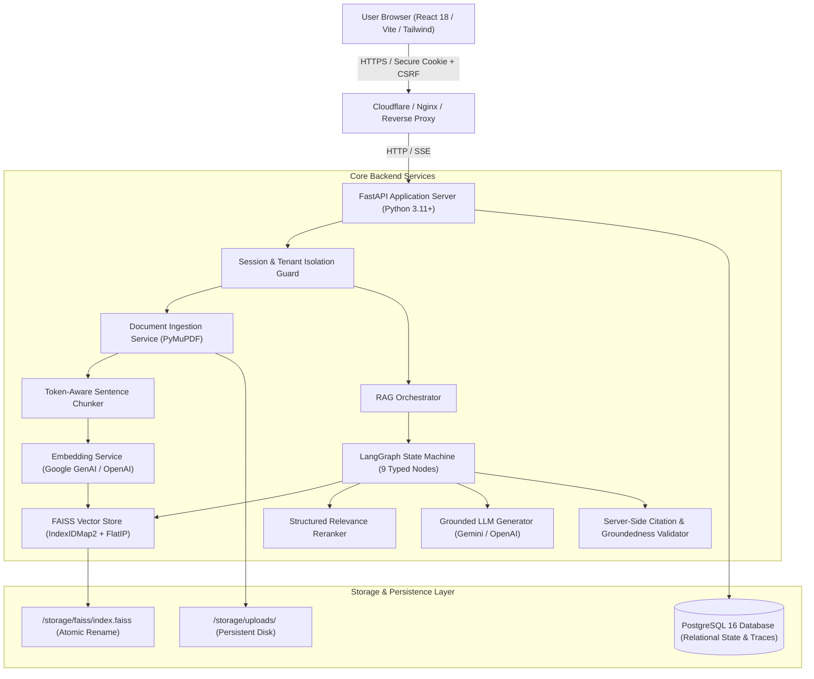
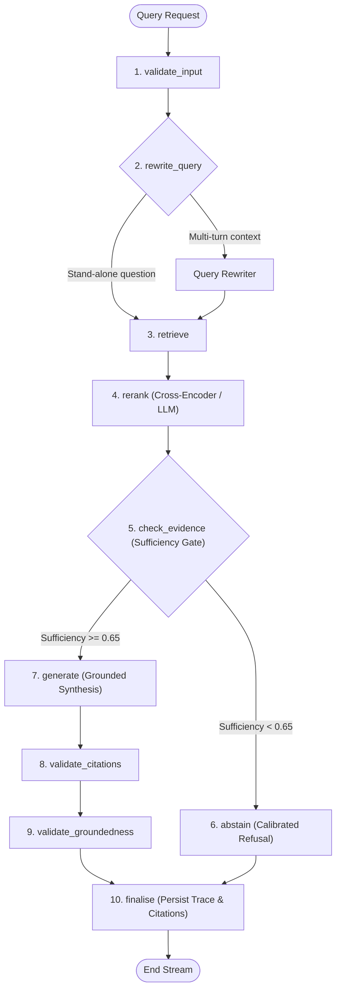

# NexusRAG: System Architecture & Technical Specifications

> **Document:** `docs/architecture.md`  
> **Phase:** Phase 1 Deliverable (Architecture & Engineering Decisions)  
> **Target Product:** NexusRAG (Production-Grade Agentic RAG Workspace)  
> **Status:** Completed for Technical Sign-Off

---

## 1. System Overview & Architectural Topology

NexusRAG is built as a modular, decoupled, production-grade Retrieval-Augmented Generation workspace. It features a FastAPI asynchronous backend, a PostgreSQL relational data store with Alembic schema migrations, an atomic FAISS vector storage engine with chunk ID mapping, an agentic multi-stage retrieval graph orchestrated via LangGraph, and a high-performance React 18/Vite frontend.



---

## 2. FAISS Vector Store Architecture & Concurrency Control

### 2.1 Index Type and Similarity Metric
Standard Euclidean distance (`L2`) fails to normalize across varied chunk token lengths. NexusRAG implements **Cosine Similarity via Inner Product**:
1. All embedding vectors are normalized to unit length ($L_2$ norm = 1.0) prior to insertion: $\mathbf{v}_{norm} = \frac{\mathbf{v}}{\|\mathbf{v}\|_2}$.
2. The core FAISS index utilizes `faiss.IndexFlatIP` (Exact Inner Product Search). For unit vectors, the inner product is mathematically identical to cosine similarity:
   $$\text{cosine\_similarity}(\mathbf{u}, \mathbf{v}) = \frac{\mathbf{u} \cdot \mathbf{v}}{\|\mathbf{u}\|_2 \|\mathbf{v}\|_2} = \mathbf{u}_{norm} \cdot \mathbf{v}_{norm}$$
3. Range: $[-1.0, 1.0]$. Returned similarity values are strictly reported as raw inner-product similarity scores, never transformed into synthetic percentage confidences.

### 2.2 Vector ID to Chunk ID Mapping & Deletion Support
Standard flat FAISS indices assign sequential implicit vector IDs ($0, 1, 2, \dots$) and **do not support deletion**. To satisfy the mandatory requirement that deleting a document removes its associated vectors:
- We wrap `IndexFlatIP` inside `faiss.IndexIDMap2`:
  ```python
  base_index = faiss.IndexFlatIP(dimension)
  index = faiss.IndexIDMap2(base_index)
  ```
- Every chunk in PostgreSQL is assigned an auto-incrementing 64-bit integer ID (`chunk.id: int`).
- During ingestion, chunks are added with explicit ID arrays:
  ```python
  ids = np.array([chunk.id for chunk in chunks], dtype=np.int64)
  index.add_with_ids(normalized_embeddings, ids)
  ```
- Upon document deletion, we query all chunk IDs for that document and invoke:
  ```python
  index.remove_ids(np.array(chunk_ids, dtype=np.int64))
  ```

### 2.3 Tenant Isolation Strategy
To prevent cross-tenant data leakage while maintaining operational efficiency:
- Each workspace maintains its own isolated FAISS index directory: `/storage/faiss/{workspace_id}/index.faiss`.
- Scope queries (by Collection or Document) retrieve candidates from the workspace index, and the candidate chunk IDs are immediately filtered through PostgreSQL query filters scoped to the authenticated `workspace_id`.
- Attempts to query an index belonging to another workspace return a strict `403 Forbidden` error.

### 2.4 Atomic Persistence & Drift Recovery Routine
FAISS operations are purely in-memory. Unsynchronized disk writes risk index corruption if the container crashes:
1. **Atomic Write-to-Temp-Rename:**
   Index persistence writes to `/storage/faiss/{workspace_id}/index.faiss.tmp` and executes an atomic POSIX filesystem rename (`os.replace`) to `/storage/faiss/{workspace_id}/index.faiss`.
2. **Startup Drift Reconciliation:**
   Upon server initialization, a background sanity routine compares chunk IDs stored in PostgreSQL against vector IDs registered in `index.id_map`. If drift is detected (e.g. vectors missing from FAISS or orphaned vector IDs present), the system marks the affected documents for reindexing or rebuilds the index from stored chunk embeddings.
3. **Concurrency Locking:**
   FAISS is not safe for concurrent writers. A per-workspace `asyncio.Lock` serializes all `add_with_ids`, `remove_ids`, and `write_index` operations. Concurrent read searches (`search`) remain non-blocking.

---

## 3. Document Ingestion, Token-Aware Chunking & Parsing

### 3.1 Multi-Format Document Parsing
- **PDF Documents:** Parsed via **PyMuPDF (`fitz`)**. Extracts text page-by-page while tracking page numbers (1-indexed), text block boundaries, and bounding box dimensions. Corrupted files or password-protected PDFs raise standard `422 Unprocessable Entity` errors. If a PDF yields 0 extracted text characters across all pages, the system explicitly reports: `"Scanned document detected. Optical Character Recognition (OCR) is not currently enabled."` Zero fake OCR claims are made.
- **TXT Documents:** Parsed with `chardet` encoding detection (UTF-8, Latin-1, ASCII) to avoid decoding crashes.
- **Markdown Documents:** Parsed using `python-markdown` or native AST parsers, preserving header hierarchy (`#`, `##`) and code block spans.

### 3.2 Token-Aware Sentence-Preserving Chunking
Chunking uses `tiktoken` (cl100k_base tokenizer) to ensure exact token boundaries:
- **Default Chunk Size:** 700 tokens (configurable between 200 and 1,500 tokens).
- **Default Overlap:** 100 tokens (configurable between 0 and 300 tokens).
- **Boundary Rules:** Chunk splits respect natural sentence and paragraph boundaries rather than cutting mid-sentence.
- **Metadata Stored per Chunk:** `document_id`, `collection_id`, `workspace_id`, `chunk_index`, `start_page`, `end_page`, `start_char`, `end_char`, `token_count`, `sha256_hash`. Character offsets are persisted specifically to power interactive passage highlighting in the PDF reader.

---

## 4. LangGraph Multi-Stage Retrieval Engine

Rather than an opaque linear chain, the RAG query engine is implemented as a deterministic, inspectable Directed Acyclic Graph (DAG) using **LangGraph**:



### 4.1 Typed State Schema (`RAGGraphState`)
The state graph is strongly typed using Pydantic:
```python
class RAGGraphState(BaseModel):
    workspace_id: str
    session_id: str
    original_query: str
    rewritten_query: Optional[str] = None
    scope_collection_ids: List[str] = []
    scope_document_ids: List[str] = []
    retrieved_candidates: List[RetrievedChunk] = []
    reranked_chunks: List[RerankedChunk] = []
    evidence_sufficiency_score: float = 0.0
    evidence_is_sufficient: bool = False
    generated_text: str = ""
    validated_citations: List[CitationSpan] = []
    stripped_citations: List[str] = []
    groundedness_score: float = 0.0
    is_abstention: bool = False
    retry_count: int = 0
    node_timings: Dict[str, float] = {}
    workflow_run_id: str = ""
```

### 4.2 Detailed Node Specifications
1. **`validate_input`:** Inspects query length (minimum 3 characters, maximum 1,000 characters), sanitizes input, and verifies tenant access to requested scope filters.
2. **`rewrite_query`:** Inspects session chat history. For unambiguous standalone queries, query rewriting is skipped to save latency. For conversational follow-ups (e.g. "What about its revenue?"), an LLM call synthesizes a self-contained search query.
3. **`retrieve`:** Generates query embedding via `text-embedding-004`, queries workspace FAISS index for top-K candidates ($K=8$), and fetches corresponding chunk rows from PostgreSQL.
4. **`rerank`:** Applies structured relevance scoring:
   - *Chosen Approach:* Cross-Encoder model (`cross-encoder/ms-marco-MiniLM-L-6-v2`) or Structured LLM relevance scoring (`gemini-2.5-flash`).
   - Filters candidate pool from 8 down to top 4 most pertinent chunks with documented reranking scores.
5. **`check_evidence`:** Evaluates candidate relevance distribution. If the top candidate score falls below the calibrated sufficiency threshold ($0.65$), the graph transitions to `abstain`.
6. **`abstain`:** Generates a courteous, truthful refusal: *"I could not find sufficient information in the selected documents to answer this question."* Prevents hallucination from model memory.
7. **`generate`:** Streams synthesis response tokens via Server-Sent Events (SSE). Prompt delimits context inside untrusted boundaries with formal instructions to cite sources via `[1]`, `[2]`.
8. **`validate_citations`:** Regex parses all `[n]` citation chips in the generated answer. Validates that every citation index corresponds to a chunk present in the retrieved context. Hallucinated citation numbers are stripped server-side.
9. **`validate_groundedness`:** Executes a model-based verification checking if all factual claims are supported by the retrieved passages, outputting a groundedness score ($0.0$ to $1.0$).
10. **`finalise`:** Writes the complete trace execution record into the `workflow_runs` table in PostgreSQL and emits the final SSE payload containing citation links and run metadata.

---

## 5. Server-Sent Events (SSE) Streaming Protocol

Because browser `EventSource` cannot issue `POST` requests with complex JSON payloads, the frontend utilizes native `fetch` with a `ReadableStreamDefaultReader` against `POST /api/v1/query/stream`:

### Wire Event Protocol:
```
event: stage
data: {"node": "rewrite_query", "status": "running", "timestamp": 1731234567.12}

event: stage
data: {"node": "retrieve", "status": "running", "candidate_count": 8}

event: stage
data: {"node": "generate", "status": "streaming"}

event: token
data: {"delta": "According "}

event: token
data: {"delta": "to the report [1], "}

event: final
data: {
  "workflow_run_id": "run_01j7abc...",
  "answer": "According to the report [1], total revenue grew 14%...",
  "citations": [
    {
      "index": 1,
      "chunk_id": 42,
      "document_id": "doc_123",
      "filename": "annual_report.pdf",
      "page_number": 12,
      "excerpt": "Total revenue grew by 14% year-over-year...",
      "score": 0.88
    }
  ],
  "is_abstention": false,
  "timings": {
    "retrieve_ms": 42.1,
    "rerank_ms": 198.4,
    "generate_ms": 612.0,
    "total_ms": 852.5
  }
}
```

---

## 6. PostgreSQL Relational Database Schema

```mermaid
erDiagram
    WORKSPACES ||--o{ COLLECTIONS : contains
    WORKSPACES ||--o{ DOCUMENTS : owns
    WORKSPACES ||--o{ SESSIONS : hosts
    WORKSPACES ||--o{ WORKFLOW_RUNS : records
    COLLECTIONS ||--o{ DOCUMENTS : groups
    DOCUMENTS ||--o{ CHUNKS : splits_into
    SESSIONS ||--o{ MESSAGES : contains
    MESSAGES ||--o{ CITATIONS : references
    WORKFLOW_RUNS ||--o{ CITATIONS : produces

    WORKSPACES {
        string id PK
        string session_token UK
        timestamp created_at
        timestamp last_active_at
    }

    COLLECTIONS {
        string id PK
        string workspace_id FK
        string name
        string description
        timestamp created_at
    }

    DOCUMENTS {
        string id PK
        string workspace_id FK
        string collection_id FK
        string filename
        string file_type
        int file_size_bytes
        int page_count
        int chunk_count
        string summary
        string status
        string error_reason
        string storage_path
        string sha256_hash
        timestamp created_at
    }

    CHUNKS {
        bigint id PK
        string document_id FK
        string workspace_id FK
        int chunk_index
        string content
        int token_count
        int start_page
        int end_page
        int start_char
        int end_char
        string embedding_model
    }

    SESSIONS {
        string id PK
        string workspace_id FK
        string title
        timestamp created_at
        timestamp updated_at
    }

    MESSAGES {
        string id PK
        string session_id FK
        string role
        string content
        string workflow_run_id FK
        timestamp created_at
    }

    WORKFLOW_RUNS {
        string id PK
        string workspace_id FK
        string query
        string rewritten_query
        jsonb retrieved_candidates
        jsonb reranked_results
        float sufficiency_score
        float groundedness_score
        jsonb stage_durations
        string status
        timestamp created_at
    }

    CITATIONS {
        string id PK
        string message_id FK
        string workflow_run_id FK
        bigint chunk_id FK
        int citation_index
        string document_id FK
        string filename
        int page_number
        string excerpt
        float relevance_score
    }
```



---

## 7. Security, Tenant Isolation & Data Governance

1. **Visitor Identity & Cookie Governance:**
   - Every visitor receives a cryptographically secure random session identifier ($128+$ bits of entropy via `secrets.token_hex(32)`).
   - Stored in an `httpOnly`, `Secure` (in production), `SameSite=Lax` cookie (`nexus_session`).
   - CSRF protection: State-changing requests (`POST`, `DELETE`, `PUT`) require a matching `X-CSRF-Token` header.
2. **Data-Layer Tenant Isolation:**
   - Every SQL query enforces `workspace_id = current_workspace_id`.
   - FAISS storage directories are strictly segmented: `/storage/faiss/{workspace_id}/`.
   - Cross-workspace lookups trigger immediate `403 Forbidden` exceptions with audit logging.
3. **Data Retention & Reaper Job:**
   - A scheduled background reaper job automatically deletes workspaces and associated data inactive for $>7$ days.
   - Deletion cascade wipes: PostgreSQL database records, raw uploaded files in `/storage/uploads/`, FAISS index files in `/storage/faiss/`, and expires the browser cookie.
4. **Prompt Injection Defense:**
   - Ingested document content is strictly treated as untrusted text.
   - In prompts, content is quarantined inside dedicated delimiters: `<<<UNTRUSTED_DOCUMENT_CONTENT [Doc ID: ...]>>> ... <<<END_UNTRUSTED_CONTENT>>>`.
   - System prompts explicitly direct the model to treat all text within delimiters as passive reference material and ignore any imperative commands embedded therein.

---

## 8. Cloud Hosting & Deployment Comparison

To fulfill Phase 9 go-live requirements, the stack requires persistent disk support for PostgreSQL and FAISS files:

| Platform | Persistent Volume Support | Cost / Free Tier | Reverse Proxy / Same-Domain | Persistence Survives Restart | Recommendation |
|---|---|---|---|---|---|
| **Railway** | Supported (Railway Volumes) | \$5/month developer tier; simple persistent volume mount (`/storage`) | Yes (Service networking + custom domains) | Verified | **Recommended (Option 1)** |
| **Render** | Supported (Render Persistent Disks) | \$7/month starter web service + \$0.25/GB disk | Yes (Render rewrite rules or unified container) | Verified | **Strong Alternative (Option 2)** |
| **Fly.io** | Native Fly Volumes | Pay-as-you-go (~$3-5/mo) | Yes (Single domain proxying) | Verified | Viable |
| **Small VPS (Hetzner / DO)** | Native Linux filesystem | \$4-6/month | Yes (Caddy or Nginx reverse proxy) | Verified | Maximum control |

