# NexusRAG Real-World Transformation Plan (Step 3)
**Date:** November 11, 2026  
**Document Status:** Complete Transformation Architecture & Execution Plan  
**Target:** Ready for User Review and Formal Approval Before Implementation Phase T1

---

## 1. Executive Summary

Based on the forensic audit in [`docs/transform-audit.md`](file:///Users/harsh/Desktop/RAG%20Assistant/docs/transform-audit.md) and competitive benchmark analysis in [`docs/transform-research.md`](file:///Users/harsh/Desktop/RAG%20Assistant/docs/transform-research.md), this plan details the complete restructuring of NexusRAG into a commercially credible, reference-grade, production RAG product.

The implementation is structured into eight focused phases (**T1** through **T8**), prioritizing the immediate elimination of blockers (fabricated hero proof, fake reviews, copied copy, and landing-in-shell nesting) before rolling out dedicated routing, full Page 7 settings, functional onboarding, and the public marketing/docs ecosystem.

---

## 2. Visual Identity & Design Tokens

NexusRAG retains its warm, architectural palette (Option 1) while completely overhauling the UI chrome to eliminate all SaaS clichés, fake window chrome, and decorative monospace typography.

### 2.1 Core Palette Tokens
- **Light Theme (Default):**
  - **Canvas (Background):** `#F7F6F2` (Warm Architectural Sand)
  - **Surface (Panels & Cards):** `#FFFFFF` (Crisp Pure White)
  - **Surface Subtle:** `#EFECE6` (Warm Muted Wash)
  - **Border (Hairline):** `#E2DDD5` (Neutral Stone Border, 1px)
  - **Border Strong:** `#C8C2B7` (High-contrast structural divider)
  - **Ink (Primary Typography):** `#18191B` (Deep Charcoal Ink)
  - **Ink Muted (Secondary):** `#64666E` (Neutral Slate)
  - **Ink Faint:** `#989AA2` (Subtle metadata and placeholders)
  - **Brand Accent:** `#B84A28` (Burnished Terracotta Ochre)
  - **Brand Hover:** `#9E3E20`
  - **Citation Highlight:** `#D96E43` (Amber Terracotta with 15% opacity background wash)
  - **Status Success / Warning / Error:** `#287C4F` / `#C27A1B` / `#B82828`
- **Dark Theme (Engineered Night Mode):**
  - **Canvas:** `#0F1115` (Deep Slate Graphite)
  - **Surface:** `#16191F` (Elevated Obsidian)
  - **Surface Subtle:** `#1E232B`
  - **Border:** `#282D37`
  - **Ink:** `#ECEEF2` (Crisp Soft White)
  - **Ink Muted:** `#9096A2`
  - **Brand Accent:** `#D96E43` (Vibrant Terracotta for dark contrast)

### 2.2 Typography Pairing & Scale
- **Interface Chrome (Navigation, Buttons, Labels, Tables):** `Inter` (sans-serif), regular (`400`), medium (`500`), and semibold (`600`).
- **Synthesis Answers & Document Reading:** `Source Serif 4` (serif), regular (`400`) and italic (`400i`), line height `1.65`, comfortable reading measure (65-75 characters).
- **Code, Hashes, Vectors & Raw Data:** `JetBrains Mono` (monospace) used **strictly for functional technical identifiers**. All decorative uppercase monospace labels (`STORAGE & HEALTH TELEMETRY`) are converted to clean Inter UI sans.
- **Rules:** Zero emoji icons (Lucide React exclusively); zero em dashes anywhere; zero pill-shaped buttons (rectangular geometry with 4px to 6px corner radius).

### 2.3 Motion & Transitions
- **Timing:** 120ms to 180ms ease-out transitions for interactive hovers, modal reveals, and accordion toggles.
- **Signature Functional Motion:** A subtle, animated connector line linking an active inline citation chip `[1]` to the corresponding passage card in the right evidence drawer.
- **Accessibility:** Full `prefers-reduced-motion` compliance disabling spatial transitions when requested.

---

## 3. Originality-Checked Copy Deck

Every user-facing string has been rewritten from scratch, audited against live search engines, and calibrated to avoid hyperbole.

| Location | Old / Copied String | New Original & Calibrated String | Originality & Tone Rationale |
|---|---|---|---|
| **Site Tagline** | *"Ask your documents. See the passage that answers."* | **"Trace every answer to the sentence that proves it."** | Replaces string shared with DocuMind AI; emphasizes auditable citation tracing. |
| **Hero Announcement** | *"NEW Your knowledge base + enterprise search, finally working together →"* | **"Transparent Document Synthesis with LangGraph Traces →"** | Replaces Slite marketing slogan with an authentic description of NexusRAG's core value. |
| **Hero Headline** | *"Where document research thrives"* | **"Verifiable Research Synthesis for Complex Documents"** | Concrete, enterprise-grade, and free of marketing clichés. |
| **Hero Subtitle** | *"Skip hallucinated answers: NexusRAG delivers verifiable research..."* | **"NexusRAG analyzes PDFs, technical manuals, and research reports with sentence-level citations and inspectable retrieval graphs."** | Calibrated; removes false claim of "skipping hallucinations". |
| **Dashboard Greeting** | *"Welcome / What will you discover today?"* | **"Research Workspace / Query your indexed collections"** | Replaces Reference 4 copy with functional, verb-first direction. |
| **Dashboard Tiles** | *"Upload / Import / Create / Learn"* | **1. "Add Sample Documents" • 2. "Upload Files" • 3. "New Session" • 4. "System Guide"** | Replaces dead or ambiguous tile labels with functional operational paths. |
| **Settings Header** | *"Zero Static Data Compliance Verification"* | **"Retrieval Engine & Pipeline Configuration"** | Replaces internal developer checklist with authentic end-user system settings. |
| **Footer Attribution** | *"ShadowFox AI Track Advanced Level"* | **"NexusRAG Research Engine • Open Source Workspace"** | Moves internship markers to `README.md` and submission package. |
| **Grounding Disclosure** | *"Citation Integrity: 100% verified"* | **"Every citation links to an exact character offset in the source document."** | Replaces unprovable "100%" claim with a verifiable technical fact. |

---

## 4. Information Architecture & Routing

### 4.1 Route Map
NexusRAG's architecture cleanly bifurcates into the **Public Marketing & Documentation Site** (`/`) and the **Authenticated Application Workspace** (`/app/*`):

```mermaid
graph TD
    Root["/ (Public Website Layout)"]
    Root --> Landing["/ (Landing Page with Real Proof)"]
    Root --> HowItWorks["/how-it-works"]
    Root --> Features["/features"]
    Root --> SecurityPage["/security"]
    Root --> FAQPage["/faq"]
    Root --> Docs["/docs (Help Center & API Explorer)"]
    Root --> StatusPage["/status (Live Backend Telemetry)"]
    Root --> AboutContact["/contact & /about"]
    Root --> Legal["/privacy & /terms"]

    App["/app (Application Shell Layout)"]
    App --> Dashboard["/app/dashboard (Real Metrics & Activity)"]
    App --> Library["/app/knowledge (Collections & Upload Tray)"]
    App --> Research["/app/research (3-Panel Synthesis Desk)"]
    App --> Reader["/app/reader (PDF Viewer & Highlighting)"]
    App --> Inspector["/app/inspector (LangGraph Trace Waterfall)"]
    App --> Settings["/app/settings (Page 7 Spec Parameters)"]
```

### 4.2 Application Shell Chrome
- **Left Navigation Rail:**
  - 200px width (collapsible to 64px icon mode) with explicit text labels.
  - Workspace selector dropdown at the top with session continuity details.
  - Active indicator: Crisp 3px terracotta left border + subtle background tint.
  - Zero overlapping tooltips.
- **Top Bar:**
  - Dynamic breadcrumb navigation (`NexusRAG > Knowledge Bases > Annual Financials`).
  - Global Search / Command Palette launcher (`Cmd+K`).
  - Degraded connection indicator (rendered **only** when backend or FAISS encounters an error; otherwise hidden).
- **Global Command Palette (`Cmd+K` / `Ctrl+K`):**
  - Instant keyboard access to: Ingest sample documents, Upload files, Create collection, Start research query, Jump to Document Reader, Open Retrieval Inspector, Toggle theme, and Open Documentation.

---

## 5. Specification Gap Decisions & Resolution Matrix

### 5.1 Database: SQLite vs. PostgreSQL Resolution
- **Spec Requirement:** PostgreSQL for application metadata in Docker Compose (Requirements G1, P2).
- **Audit Finding:** Native local development used SQLite 3 via SQLAlchemy.
- **Formal Decision:** **Dual-Dialect Architecture (Fully Justified & Documented)**.
  - SQLAlchemy 2.0 models and Alembic migrations are maintained in a 100% dialect-agnostic format (`backend/app/models/` and `alembic/versions/`).
  - In `docker-compose.yml`, PostgreSQL 16 is orchestrated as the primary production database with persistent named volumes (`nexusrag_pgdata`).
  - In native local development without Docker, the backend gracefully falls back to SQLite (`sqlite:///./data/nexusrag.db`) to enable friction-free evaluation without requiring local PostgreSQL daemon installation.
  - In production deployment (Railway / Render / VPS), `DATABASE_URL` is pointed to PostgreSQL.

### 5.2 Settings Page (Spec Page 7 Completion)
The current settings page will be upgraded to include all required configuration sections:
1. **AI Provider Configuration Status:** Shows active provider (`Google Gemini` or `OpenAI`), connection health, and API key presence without exposing raw keys.
2. **Model Selection:** Dropdown selector for generation model (`gemini-2.5-flash`, `gemini-2.0-flash`) and embedding model (`text-embedding-004`).
3. **RAG Chunking Parameters:** Sliders with numeric inputs for chunk size (200-1500 tokens, default 700) and chunk overlap (50-300 tokens, default 100).
4. **Retrieval Controls:** Top-K retrieved candidates (4-16, default 8), final reranked context count (2-8, default 4), and sufficiency threshold (0.50-0.85, default 0.65).
5. **Data & Privacy Controls:** One-click Data Export (ZIP bundle of documents, sessions, and traces) and Data Purge (permanently wipes DB records, FAISS vectors, and files).

### 5.3 Knowledge Bases & Collection Management
- **Collection Rename:** Implement `PUT /api/v1/collections/{id}` in backend and wire an inline edit/modal in the frontend collection tree.
- **Bulk Document Operations:** Implement checkbox selection in the document table with bulk reindexing and bulk deletion actions.
- **Upload Tray Progress:** Ensure the upload tray continues to stream real byte progress via `xhr.upload.onprogress` with per-file abort handles.

---

## 6. Hosting & Production Deployment Analysis

NexusRAG requires a container runtime with persistent disk volumes for uploaded files (`/storage/uploads`), SQLite/PostgreSQL storage, and atomic FAISS vector index files (`/storage/faiss`).

### Hosting Comparison (Verified Official Pricing, November 2026)

| Provider | Persistent Disk Cost | Compute & Memory Tier | Reverse Proxy / Same-Site Domain | Deployment Method | Evaluation & Fit for NexusRAG |
|---|---|---|---|---|---|
| **Railway** | **$0.15 / GB / month** (billed per-second) | $5/month Hobby plan (includes $5 usage credit covering CPU & RAM) | Single custom domain with path-based routing (`/api` -> backend, `/` -> frontend); secure cookie works out of the box | Dockerfile or GitHub auto-deploy | **RECOMMENDED**. Turnkey persistent volumes, zero maintenance, native environment variables, predictable usage pricing. |
| **Render** | **$0.25 / GB / month** | $7/month Starter Web Service + $7/month Managed PostgreSQL | Supports custom domains; single-service limitation when persistent disk is attached | Dockerfile | **VIABLE**. Higher disk cost ($0.25 vs $0.15) and service scaling is locked to 1 instance when using persistent disks. |
| **Fly.io** | **$0.15 / GB / month** | ~$5-$8/month for shared-cpu-1x with 1GB RAM | Multi-region routing with built-in SSL | `fly.toml` + `fly volumes create` | **VIABLE**. Requires CLI-centric configuration; excellent performance but slightly steeper setup curve. |
| **Hetzner / DO VPS** | Included in VPS storage (e.g. 40GB NVMe SSD) | $4.50 - $6.00 / month flat | Caddy or Nginx reverse proxy routing to Compose containers | `docker compose up -d` on server | **HIGHEST CONTROL**. 100% parity with local Docker Compose; requires managing OS updates and security firewalls. |

**Recommendation to User:** Deploy on **Railway** using our multi-stage `Dockerfile` with persistent volume mount at `/storage`, or a **VPS with Docker Compose**.

---

## 7. Defect Priority Ranking

### Blockers (Must fix in Phase T1)
- **B1:** Remove fabricated proof, fake financial charts, and synthetic claims from `LandingPage.jsx`.
- **B2:** Delete the synthetic customer testimonial card attributed to ShadowFox internship.
- **B3:** Rewrite all copied reference strings (announcement pill, greeting, action tiles, table controls, underline gesture).
- **B4:** Replace reused tagline with NexusRAG's original positioning (*"Trace every answer to the sentence that proves it."*).
- **B5:** Separate public marketing website (`/`) from the application workspace shell (`/app/*`).

### High Priority (Phases T2 & T3)
- **H1:** Replace empty dashboard with live aggregate metrics (Documents, Collections, Chunks, Active Sessions).
- **H2:** Remove permanent developer status bar and raw `"ws:visitor"` tags from general UI chrome.
- **H3:** Complete Settings Page per Spec Page 7 (model selection, chunk size/overlap, top-K, provider status).
- **H4:** Implement one-click "Add Sample Documents" onboarding flow with verified public domain reports.
- **H5:** Calibrate all security and system claims (remove "skip hallucinations", "256-bit isolation", "deterministic DAG").
- **H6:** Document and formally justify SQLite vs PostgreSQL dual-dialect architecture.

### Medium Priority (Phases T3 & T4)
- **M1:** Eliminate rail nav icon tooltip overlaps; add visible labels.
- **M2:** Implement Collection Rename modal and bulk document delete/reindex.
- **M3:** Replace uppercase monospace micro-labels with clean Inter UI sans.
- **M4:** Build complete public ecosystem: `/docs` (User Guide + API), `/security`, `/faq`, `/status`, `/contact`.
- **M5:** Replace dead action tiles with real functional operational paths.

### Low Priority (Phases T4 & T5)
- **L1:** Remove internship mention from landing page footer.
- **L2:** Remove leftover four-color annotation dots from Research Desk conversation pane.
- **L3:** Replace hardcoded `"25MB"` literal in upload tray with dynamic limit from `/api/v1/system/status`.

---

## 8. Implementation Roadmap (Phases T1 through T8)

- **Phase T1: Blockers & Honesty Cleanup**
  - Purge fabricated hero cards and fake testimonials.
  - Deploy original copy deck across all pages.
  - Remove all overclaims and student internship labels from product UI.
- **Phase T2: Architectural Separation & Real Dashboard**
  - Create separate public site layout (`/`) and app shell (`/app/*`).
  - Build genuine Dashboard with live computed metrics and activity feeds.
  - Remove developer status bar and raw visitor tags.
- **Phase T3: Product Completeness & First-Run Onboarding**
  - Implement full Settings page per Spec Page 7.
  - Wire collection rename and bulk operations.
  - Add one-click "Ingest Sample Documents" onboarding feature.
  - Add global Command Palette (`Cmd+K`).
- **Phase T4: Public Site & Documentation Ecosystem**
  - Build landing page with real Playwright-captured product proof.
  - Create `/docs` (User Guides + Technical Architecture + OpenAPI Explorer).
  - Create `/security`, `/faq`, `/status`, `/about`, `/contact`, `/changelog`.
- **Phase T5: Automated Testing & Evaluation**
  - Run full Pytest and Vitest test suites.
  - Run Playwright end-to-end tests across viewports (1440, 820, 390).
  - Run originality grep audits and real-data checks.
- **Phase T6: Comprehensive Security Audit**
  - Run `pip-audit`, `npm audit`, `detect-secrets scan`.
  - Verify sliding window rate limiter, CSRF double-submit, and prompt injection defense.
- **Phase T7: Cloud Production Go-Live**
  - Configure production deployment container with persistent disk volume.
  - Configure custom domain with HTTPS and verify cookie transmission.
  - Conduct live mobile smoke test.
- **Phase T8: Final Deliverables & Submission Package**
  - Complete 26-chapter root `README.md`.
  - Author video walkthrough script and one-page technical summary.

